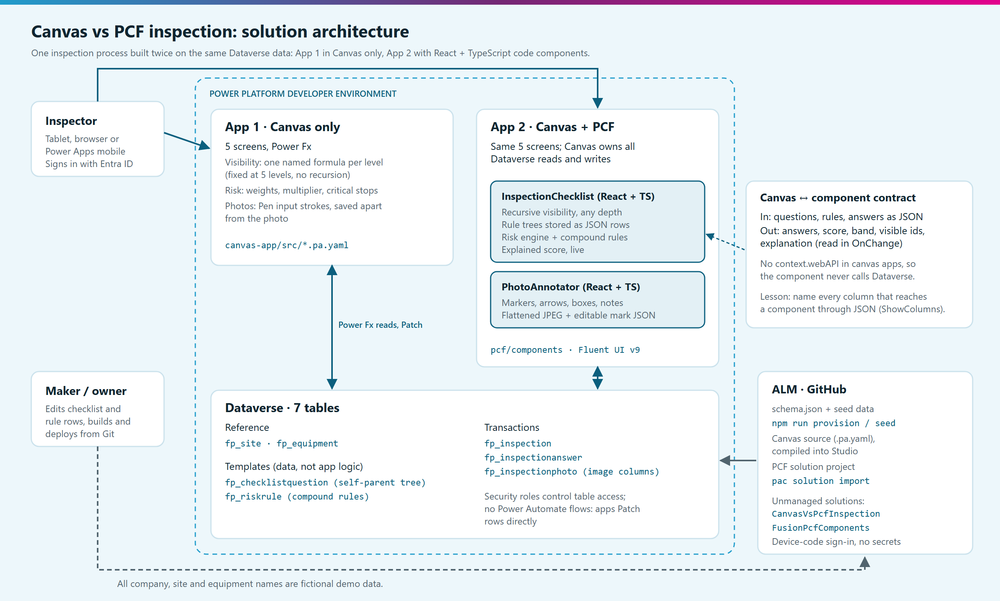

# Canvas vs PCF: one inspection app, built twice

A portfolio project by **Sohanur Rahman Sohan**, Power Platform Developer & Solution Builder.

One equipment-inspection process, built twice on the same Dataverse data. **App 1** is a Canvas app pushed as far as Power Fx reasonably goes. **App 2** keeps the same screens and moves the parts that hit a wall (a recursive checklist, rule-based risk scoring and photo annotation) into two React + TypeScript code components built with the Power Apps component framework (PCF). The goal isn't "pro-code wins". It's to show, with two working apps and test evidence, exactly where the line is and what it costs to cross it.



## The problem

A fictional manufacturer inspects forklifts and conveyors across three warehouse sites. Inspectors need:

1. **A nested checklist that adapts.** Questions appear based on earlier answers, up to six levels deep, and some depend on answers in another branch.
2. **A live risk score** with weights, an equipment-criticality multiplier, critical stops that force the top band, and compound hazards (two findings together score more than each alone).
3. **Photo annotation.** Mark the defect on the photo itself, with numbered markers, arrows, boxes and notes.
4. **Dataverse** as the system of record, with checklist templates and risk rules stored as data, so changing a template doesn't need a new app version.

## How the two apps work

| | App 1 · Canvas only | App 2 · Canvas + PCF |
| --- | --- | --- |
| Screens | Inspections list, guided start, staged checklist, photos, review and submit | The same five screens |
| Conditional questions | One named formula per level (`VisL0`–`VisL4`). Power Fx functions can't recurse, so depth is fixed at five | `InspectionChecklist` walks the tree recursively, so there's no depth limit |
| Cross-branch rules | Hard-coded formula for the one rule-gated question | Any `any`/`all` rule tree stored as JSON on the question row |
| Risk score | Weights, multiplier, cap and critical stops | The same, plus compound rules from the `fp_riskrule` table and a line-by-line explanation |
| Photo annotation | Pen input: freehand strokes, saved apart from the photo | `PhotoAnnotator`: markers, arrows, boxes, freehand and notes, saved as a flattened JPEG plus editable mark data |
| Data access | Power Fx reads and `Patch` | The same. Canvas still owns every Dataverse call |

**The boundary in App 2.** Code components in canvas apps have no Dataverse Web API (`context.webAPI`). So the Canvas app loads questions, rules and answers, passes them to the component as JSON input properties, and reads answers, score, band and explanation back from output properties in `OnChange`. The component owns interaction and logic; Canvas owns data. Details: [pcf/DESIGN.md](pcf/DESIGN.md).

**A lesson from testing.** In App 2's first traced run every question was visible and nothing scored. Power Apps' explicit column selection fetches only the columns the app visibly uses, and the questions reached the component only through `JSON(DropColumns(colQ, Rec))`, so the parent, condition and weight columns were never requested. Naming every column with `ShowColumns` fixed it. Anything a code component reads through JSON has to be named somewhere the analyzer can see.

## Tech stack

| Layer | Used |
| --- | --- |
| Apps | Power Apps canvas apps, Power Fx (named formulas, user-defined functions) |
| Code components | Power Apps component framework (virtual React controls), React 16 (platform), TypeScript, Fluent UI v9 |
| Data | Dataverse: 7 tables, choice columns, image columns, a self-referencing lookup |
| Tooling | Power Platform CLI (`pac`), .NET SDK (solution project), Node.js (provisioning and tests), canvas-apps authoring MCP, Monitor |
| ALM | Git and GitHub, unmanaged solutions in a Developer environment |

## Repository layout

```
dataverse/     schema.json, seed data, provision and seed scripts (Node, Dataverse Web API)
canvas-app/    App 1: design notes and the .pa.yaml source
canvas-app-2/  App 2: the .pa.yaml source
pcf/           App 2: the two code components, their tests and the solution project
docs/          data model, "Where Canvas stopped", architecture diagram
```

## Install it in your own environment

Everything was built in a free Power Apps Developer Plan environment. All data is fictional.

> **Heads-up:** Microsoft is retiring unmanaged developer environments, the kind the Developer Plan creates. New ones can't be created from 15 November 2026, existing ones are suspended from 15 December 2026 and deleted from 15 January 2027 ([Developer Plan guide](https://learn.microsoft.com/en-us/power-platform/developer/plan)). Use a trial or another non-production environment instead.

1. **Dataverse tables and demo data.** Needs Node.js 20 or later.
   ```bash
   cd dataverse
   npm install
   npm run validate
   DATAVERSE_URL=https://yourorg.crm.dynamics.com npm run provision
   DATAVERSE_URL=https://yourorg.crm.dynamics.com npm run seed
   ```
   Sign-in uses the device-code flow in your browser; no password or secret goes into the scripts. See [docs/data-model.md](docs/data-model.md).
2. **Code components.** Needs Node.js 24 (the tests run TypeScript directly), the .NET SDK and the Power Platform CLI.
   ```bash
   cd pcf/components && npm install && npm test
   cd ../solution && dotnet build -c Release
   pac auth create --environment https://yourorg.crm.dynamics.com --deviceCode
   pac solution import --path bin/Release/solution.zip --publish-changes
   ```
   In the Power Platform admin center, turn on **Allow publishing of canvas apps with code components** for the environment. See [pcf/README.md](pcf/README.md).
3. **Canvas apps.** For each app, create a blank tablet canvas app in the `CanvasVsPcfInspection` solution, turn on co-authoring and add the `fp_` tables. Then paste each screen's YAML from [canvas-app/src](canvas-app/src) (App 1) or [canvas-app-2/src](canvas-app-2/src) (App 2) into Studio with **Paste code**, or compile the folder with the canvas-apps authoring tools. App 2 also needs the code components from step 2. See [canvas-app/README.md](canvas-app/README.md).

## Screenshots

Screenshots coming soon.

## Further reading

- [docs/data-model.md](docs/data-model.md): tables, the checklist tree and the risk model
- [docs/where-canvas-stopped.md](docs/where-canvas-stopped.md): App 1's limits, with evidence from the build and three traced test runs
- [pcf/DESIGN.md](pcf/DESIGN.md): App 2's design, progress log and lessons

## Status

- [x] Data model, provisioning and seed scripts
- [x] App 1: Canvas app, signed off after three Monitor-traced test runs
- [x] App 2: two code components (15 unit tests) and the Canvas app, merged to main
- [ ] App 2: final traced test after the column-selection fix
- [ ] Screenshots and the "How pro-code solved it" write-up

All company, site and equipment names are fictional.
