# Canvas vs PCF: one inspection app, built twice

A portfolio project by **Sohanur Rahman Sohan**, Power Platform Developer & Solution Builder.

One equipment-inspection process, built twice on the same Dataverse data. **App 1** is a Canvas app pushed as far as Power Fx reasonably goes. **App 2** keeps the same screens and moves the parts that hit a wall (a recursive checklist, rule-based risk scoring and photo annotation) into two React + TypeScript code components built with the Power Apps component framework (PCF). The goal isn't "pro-code wins". It's to show, with two working apps and test evidence, exactly where the line is and what it costs to cross it.

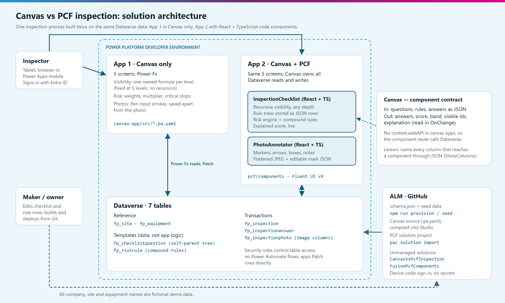

**App 1 demo video and case study:** [srs014.github.io/projects/canvas-equipment-inspections](https://srs014.github.io/projects/canvas-equipment-inspections/) · [watch the video in this repo](docs/demo/equipment-inspections-demo.mp4)

**App 2 demo video and case study:** [srs014.github.io/projects/canvas-pcf-rules-driven-inspections](https://srs014.github.io/projects/canvas-pcf-rules-driven-inspections/) · [watch the video in this repo](docs/demo/rules-driven-inspections-demo.mp4)

## The problem

A fictional manufacturer inspects forklifts and conveyors across three warehouse sites. Inspectors need:

1. **A nested checklist that adapts.** Questions appear based on earlier answers, up to six levels deep, and some depend on answers in another branch.
2. **A live risk score** with weights, an equipment-criticality multiplier, critical stops that force the top band, and compound hazards (two findings together score more than each alone).
3. **Photo annotation.** Mark the defect on the photo itself, with numbered markers, arrows, boxes and notes.
4. **Dataverse** as the system of record, with checklist templates and risk rules stored as data, so changing a template doesn't need a new app version.

## How the two apps work

| | App 1 · Canvas only | App 2 · Canvas + PCF |
| --- | --- | --- |
| Screens | Inspections list, guided start, staged checklist, photos, review and submit | The same five screens |
| Conditional questions | One named formula per level (`VisL0`–`VisL4`). Power Fx functions can't recurse, so depth is fixed at five | `InspectionChecklist` walks the tree recursively, so there's no depth limit |
| Cross-branch rules | Hard-coded formula for the one rule-gated question | Any `any`/`all` rule tree stored as JSON on the question row |
| Risk score | Weights, multiplier, cap and critical stops | The same, plus compound rules from the `fp_riskrule` table and a line-by-line explanation |
| Photo annotation | Pen input: freehand strokes, saved apart from the photo | `PhotoAnnotator`: markers, arrows, boxes, freehand and notes, saved as a flattened JPEG plus editable mark data |
| Data access | Power Fx reads and `Patch` | The same. Canvas still owns every Dataverse call |

**The boundary in App 2.** Code components in canvas apps have no Dataverse Web API (`context.webAPI`). So the Canvas app loads questions, rules and answers, passes them to the component as JSON input properties, and reads answers, score, band and explanation back from output properties in `OnChange`. The component owns interaction and logic; Canvas owns data. Details: [pcf/DESIGN.md](pcf/DESIGN.md).

**A lesson from testing.** In App 2's first traced run every question was visible and nothing scored. Power Apps' explicit column selection fetches only the columns the app visibly uses, and the questions reached the component only through `JSON(DropColumns(colQ, Rec))`, so the parent, condition and weight columns were never requested. Naming every column with `ShowColumns` fixed it. Anything a code component reads through JSON has to be named somewhere the analyzer can see.

## Demo video

[App 1's walkthrough](docs/demo/equipment-inspections-demo.mp4) (2:42) follows one forklift inspection in the published app: the checklist growing as you answer, the sixth-level question that never appears, a critical stop, pen markup on a photo, and the submit. Playwright drives the app, and all the data is fictional. Two waits are shortened in the edit, and each cut shows how many seconds it skipped. Captions are burned in, with [.srt](docs/demo/equipment-inspections-demo.srt) and [.vtt](docs/demo/equipment-inspections-demo.vtt) files alongside. The [description](docs/demo/VIDEO-DESCRIPTION-app1.md) has chapters.

[App 2's walkthrough](docs/demo/rules-driven-inspections-demo.mp4) (2:30) follows the same inspection through the code components: the sixth-level question that App 1 could never show, a compound rule stored as a row, the data boundary, and numbered markers, arrows and boxes on a photo. It has the same captions, with [.srt](docs/demo/rules-driven-inspections-demo.srt) and [.vtt](docs/demo/rules-driven-inspections-demo.vtt) files, and its [description](docs/demo/VIDEO-DESCRIPTION-app2.md) has chapters.

Narration generated with a clone of my own voice.

## Testing

| Suite | What it covers | Result |
| --- | --- | --- |
| [App 1 end-to-end](testing/e2e) | 23 Playwright tests against the published app: home figures, starting an inspection, branching and scoring, submit, abandoning, photos and on-screen checks. They read Dataverse to confirm what was saved, and delete the rows they create | All pass |
| [App 2 end-to-end](testing/e2e) | 23 Playwright tests against the published app: the checklist and annotator components, the sixth level, stored rules and compound rules, keyboard answering, submit, abandoning and on-screen checks. They read Dataverse to confirm what was saved | All pass |
| [Code components](pcf/components/tests) | 15 unit tests for the scoring engine and the Canvas data contract | All pass |

Test C2 confirms that the sixth-level question never shows in App 1. That is the documented limit, and the point of the project.

Neither app has an offline mode. Keyboard use is covered for App 2's answer buttons only.

## The code components

Two virtual React controls replace the parts of App 1 that hit a wall. Canvas still owns every Dataverse read and write, because code components in canvas apps have no Web API.

| Component | Purpose | Inputs | Outputs |
| --- | --- | --- | --- |
| `InspectionChecklist` | Walks the question tree recursively, evaluates rules stored as JSON and explains every point in the score | `QuestionsJson`, `RulesJson`, `AnswersJson`, `Criticality`, `ReadOnly` | `AnswersOut`, `Score`, `Band`, `CriticalHit`, `AnsweredCount`, `VisibleIdsJson`, `VisibleCount`, `ExplanationJson` |
| `PhotoAnnotator` | Numbered markers, arrows, boxes, freehand and notes on a photo | `ImageDataUri`, `AnnotationJson`, `ReadOnly` | `AnnotatedImageDataUri`, `AnnotationJsonOut`, `MarkCount` |

Canvas passes data in as JSON and reads the results in the control's `OnChange`. To build and import them, see [pcf/README.md](pcf/README.md).

**Known issue.** `PhotoAnnotator` discards a freehand stroke that ends where it started, because it decides whether the pointer moved by comparing the first and last points. So a closed circle disappears, while an open curve saves. The fix is to measure the stroke's length, and it needs a new component version. The demo video draws an open arc for this reason.

## Design decisions

- **The checklist and its rules are data.** Questions are rows in a self-referencing table, so a new template doesn't need a new app version.
- **One formula per level in App 1.** Power Fx functions can't call themselves, so visibility is walked level by level. That's why the depth is fixed at five.
- **Canvas owns Dataverse in both apps.** Code components in canvas apps have no Web API, so they get their data as JSON and hand results back through output properties.
- **One batched write on Submit.** Row-by-row saving took about 1.2 s per answer in the first traced run, so answers now go in one `Collect`.
- **The source and the published app are kept matching.** A compile overwrites values set only in Studio, so I compare them in both directions before compiling, and again after publishing.

## Tech stack

| Layer | Used |
| --- | --- |
| Apps | Power Apps canvas apps, Power Fx (named formulas, user-defined functions) |
| Code components | Power Apps component framework (virtual React controls), React 16 (platform), TypeScript, Fluent UI v9 |
| Data | Dataverse: 7 tables, choice columns, image columns, a self-referencing lookup |
| Tooling | Power Platform CLI (`pac`), .NET SDK (solution project), Node.js (provisioning and tests), Playwright (end-to-end tests and demo recording), canvas-apps authoring MCP, Monitor |
| ALM | Git and GitHub, unmanaged solutions in a Developer environment |

## Repository layout

```
dataverse/     schema.json, seed data, provision and seed scripts (Node, Dataverse Web API)
canvas-app/    App 1: design notes and the .pa.yaml source
canvas-app-2/  App 2: the .pa.yaml source
pcf/           App 2: the two code components, their tests and the solution project
testing/e2e/   Playwright tests and the demo recorder
docs/          data model, "Where Canvas stopped", architecture diagram, screenshots, demo video
```

## Install it in your own environment

Everything was built in a free Power Apps Developer Plan environment. All data is fictional.

> **Heads-up:** Microsoft is retiring unmanaged developer environments, the kind the Developer Plan creates. New ones can't be created from 15 November 2026, existing ones are suspended from 15 December 2026 and deleted from 15 January 2027 ([Developer Plan guide](https://learn.microsoft.com/en-us/power-platform/developer/plan)). Use a trial or another non-production environment instead.

1. **Dataverse tables and demo data.** Needs Node.js 20 or later.
   ```bash
   cd dataverse
   npm install
   npm run validate
   DATAVERSE_URL=https://yourorg.crm.dynamics.com npm run provision
   DATAVERSE_URL=https://yourorg.crm.dynamics.com npm run seed
   ```
   Sign-in uses the device-code flow in your browser; no password or secret goes into the scripts. See [docs/data-model.md](docs/data-model.md).
2. **Code components.** Needs Node.js 24 (the tests run TypeScript directly), the .NET SDK and the Power Platform CLI.
   ```bash
   cd pcf/components && npm install && npm test
   cd ../solution && dotnet build -c Release
   pac auth create --environment https://yourorg.crm.dynamics.com --deviceCode
   pac solution import --path bin/Release/solution.zip --publish-changes
   ```
   In the Power Platform admin center, turn on **Allow publishing of canvas apps with code components** for the environment. See [pcf/README.md](pcf/README.md).
3. **Canvas apps.** For each app, create a blank tablet canvas app in the `CanvasVsPcfInspection` solution, turn on co-authoring and add the `fp_` tables. Then paste each screen's YAML from [canvas-app/src](canvas-app/src) (App 1) or [canvas-app-2/src](canvas-app-2/src) (App 2) into Studio with **Paste code**, or compile the folder with the canvas-apps authoring tools. App 2 also needs the code components from step 2. See [canvas-app/README.md](canvas-app/README.md).

## Screenshots

All sites, equipment and inspections are fictional demo data.

| App 1 · Home | App 1 · The branch stops at level five |
| --- | --- |
| 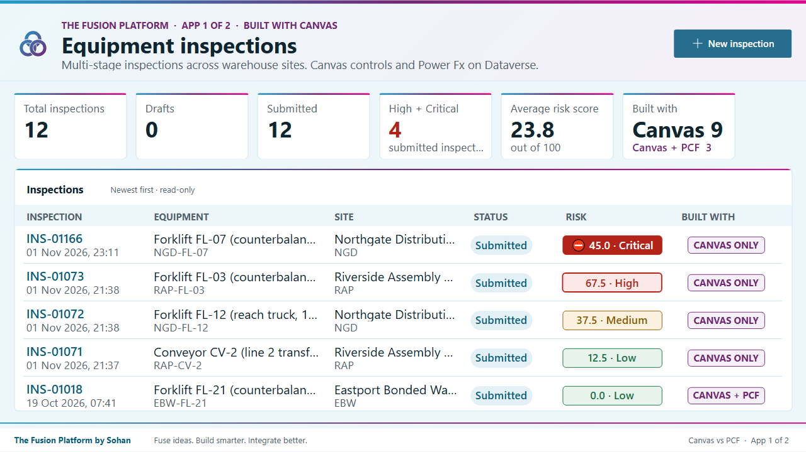 | 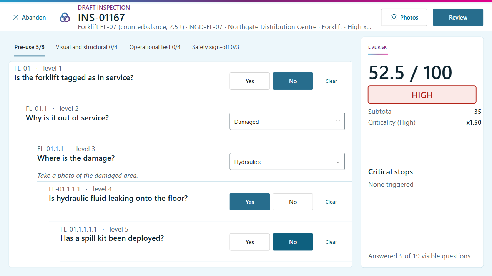 |

| App 1 · A critical stop forces the Critical band | App 1 · Review and submit |
| --- | --- |
| 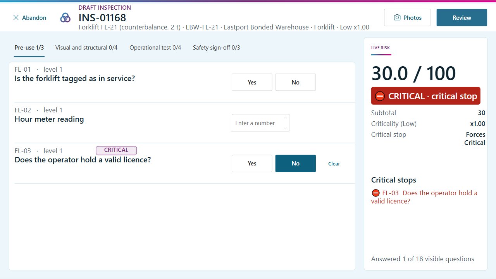 | 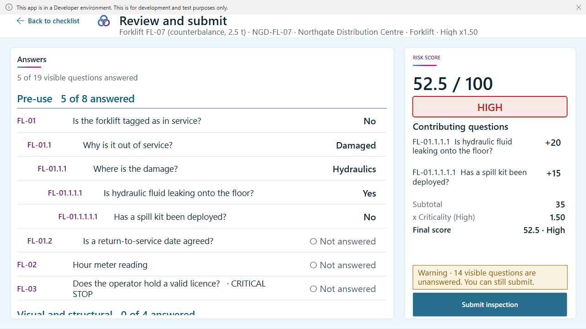 |

| App 1 · Pen markup | App 1 · Strokes saved apart from the photo |
| --- | --- |
| 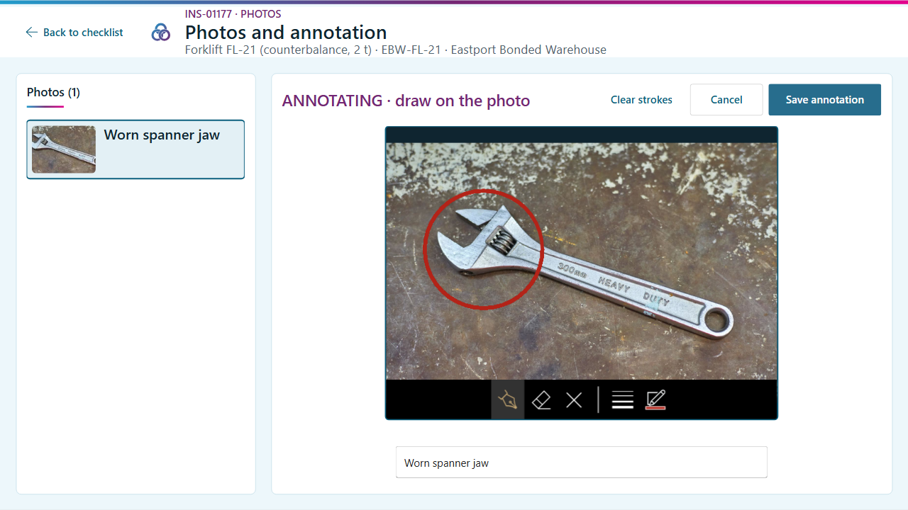 | 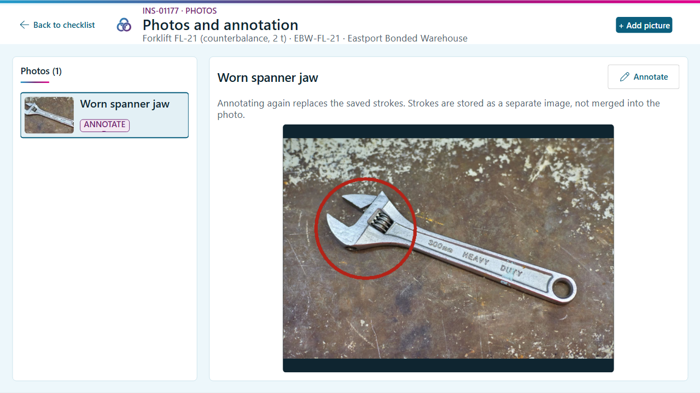 |

| App 2 · The sixth level appears and scores | App 2 · A compound rule explains itself |
| --- | --- |
| 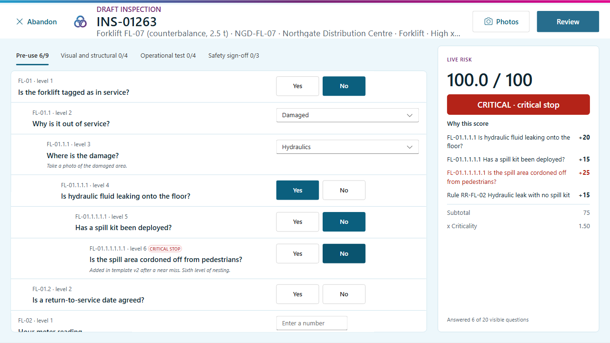 | 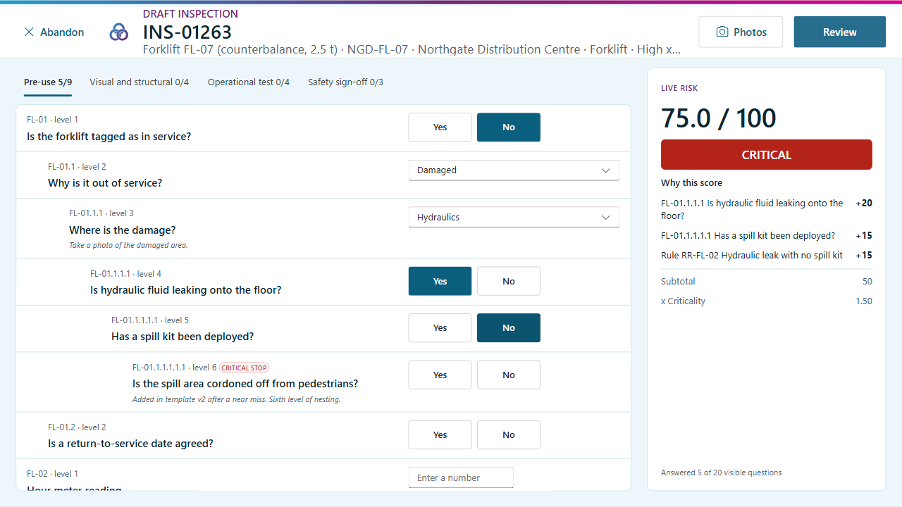 |

| App 2 · The photo annotator component | App 2 · The annotated copy, with the original kept |
| --- | --- |
| 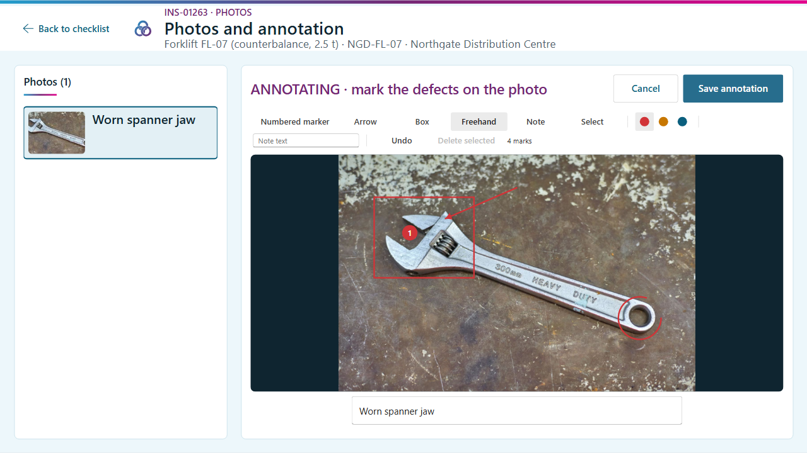 | 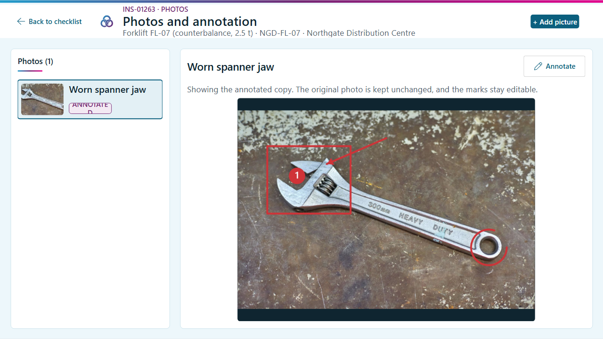 |

More screenshots and the full write-up: [the case studies on my portfolio](https://srs014.github.io/projects/).

## Further reading

- [docs/data-model.md](docs/data-model.md): tables, the checklist tree and the risk model
- [docs/where-canvas-stopped.md](docs/where-canvas-stopped.md): App 1's limits, with evidence from the build and three traced test runs
- [pcf/DESIGN.md](pcf/DESIGN.md): App 2's design, progress log and lessons
- [When to Use Code Components in Canvas Apps](https://thefusionplatform.wordpress.com/2026/10/19/when-to-use-code-components-in-canvas-apps/): the write-up on The Fusion Platform (Low-Code to Pro-Code, Part 10 of 10): the three walls, the boundary and the three traps from testing
- Portfolio case studies: [App 1](https://srs014.github.io/projects/canvas-equipment-inspections/) and [App 2](https://srs014.github.io/projects/canvas-pcf-rules-driven-inspections/)

## Status

- [x] Data model, provisioning and seed scripts
- [x] App 1: Canvas app, signed off after three test runs traced with Live monitor
- [x] App 1: 23 end-to-end tests, screenshots and demo video
- [x] App 2: two code components (15 unit tests) and the Canvas app, merged to main
- [x] App 2: scoring confirmed after the column-selection fix: an end-to-end test checks the saved score, band and each answer's contribution
- [x] App 2: 23 end-to-end tests, screenshots and demo video
- [x] Screenshots and the write-up ([blog post](https://thefusionplatform.wordpress.com/2026/10/19/when-to-use-code-components-in-canvas-apps/), 19 October 2026)

All company, site and equipment names are fictional.
