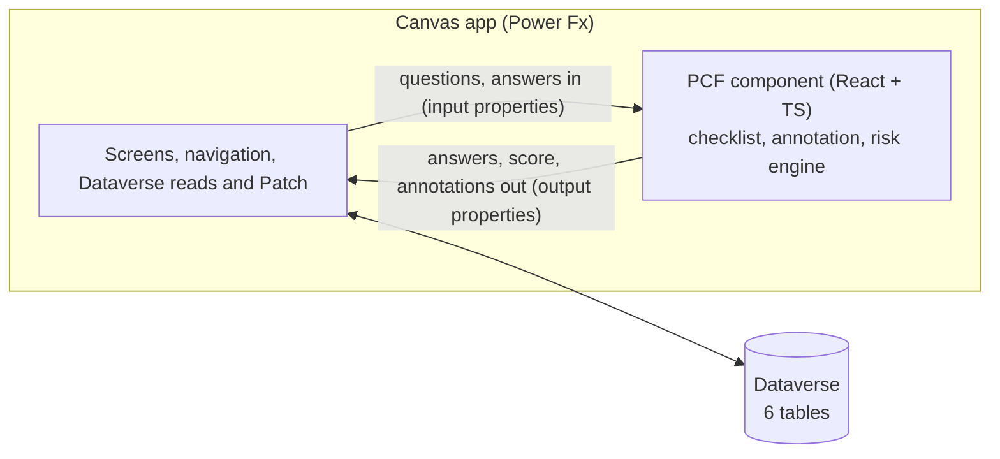

# Canvas vs Pro-Code: where low-code stops and a PCF component takes over

A portfolio project by **Sohanur Rahman Sohan**, Power Platform Developer & Solution Builder at The Fusion Platform.

> Fuse ideas. Build smarter. Integrate better.

One business problem, built twice. First as a **Canvas app**, pushed as far as Canvas reasonably goes. Then the parts that hit a wall are rebuilt as a **Power Apps component framework (PCF) code component** in React and TypeScript, which runs inside the same Canvas app on the same Dataverse data.

The point is not "pro-code is better". It's to show, with two working apps, exactly where the line is.

## The problem

A manufacturing company inspects equipment (forklifts and conveyors) across several warehouse sites. Inspectors need:

1. **A dynamic, nested checklist.** Questions appear and disappear based on earlier answers, sometimes six levels deep, and some depend on answers in a different branch.
2. **Inline photo annotation.** Take a photo, then mark the problem directly on it.
3. **A live risk score** that recalculates as the inspector answers, with critical stops and compounding hazards.
4. **Dataverse** as the system of record.

## The story

| Step | What happens | Where to look |
| --- | --- | --- |
| 1. Model the data | Six Dataverse tables. The checklist is a tree of rows with show conditions and risk rules, so templates change without changing an app. | [docs/data-model.md](docs/data-model.md) |
| 2. Build it in Canvas | Inspection list, guided start, stage-by-stage checklist with conditional visibility, photo capture, live score, submit to Dataverse. | [canvas-app/](canvas-app/) |
| 3. Find the wall | What became unmanageable, slow or impossible, with evidence from the build. | [docs/where-canvas-stopped.md](docs/where-canvas-stopped.md) |
| 4. Go pro-code | A React + TypeScript PCF component for the recursive checklist, an annotation canvas and a rules-based risk engine, embedded in the Canvas app. | [pcf/](pcf/) *(App 2)* |
| 5. Map limit to solution | Each Canvas limit, and the specific pro-code technique that removes it. | [docs/how-pro-code-solved-it.md](docs/how-pro-code-solved-it.md) *(after App 2)* |

## Architecture in one picture



PCF code components in canvas apps can't call the Dataverse Web API (`context.webAPI` isn't available there). So the Canvas app keeps owning data access, and the component owns the interaction-heavy UI and logic. That boundary is a design decision, not a workaround, and the docs explain it.

## Repository layout

```
dataverse/   schema.json, seed data, provision and seed scripts (Node, Dataverse Web API)
canvas-app/  App 1: build plan and the validated .pa.yaml source
pcf/         App 2: the React + TypeScript code component
docs/        data model, "Where Canvas stopped", "How pro-code solved it", the write-up
```

## Run it yourself

1. **Dataverse.** Follow [docs/data-model.md#provisioning](docs/data-model.md#provisioning). Two commands create the solution and load fictional demo data.
2. **Canvas app.** See [canvas-app/](canvas-app/).
3. **PCF component.** Coming with App 2.

Everything is built to run on a free Power Apps Developer Plan environment.

## Status

- [x] Data model, provisioning and seed scripts (provisioned in a Developer environment)
- [x] App 1: Canvas app, 5 screens, compiled clean against a live Studio session and signed off after three Monitor-traced test runs (2026-10-17)
- [x] "Where Canvas stopped": build evidence (A1–A10) and runtime checks (B1–B7)
- [ ] App 2: PCF component (in progress)
- [ ] "How pro-code solved it"
- [ ] Portfolio write-up

All company, site and equipment names are fictional.
