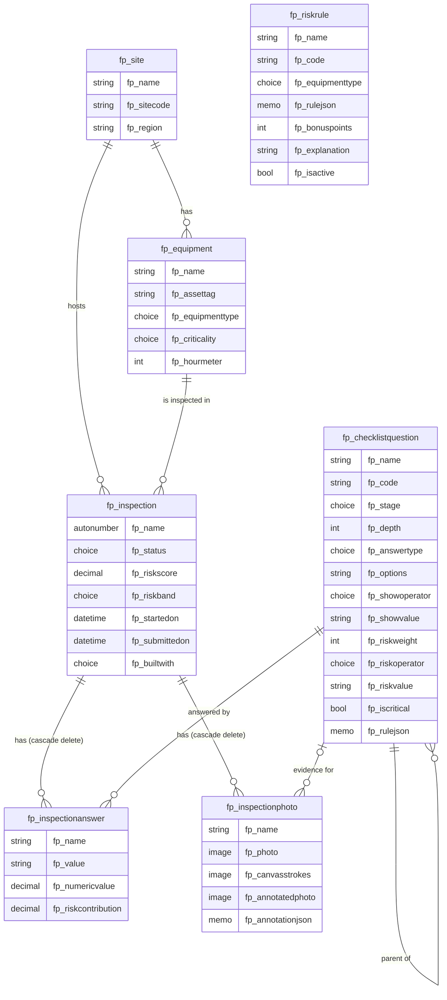

# Data model

Both apps use the same Dataverse tables, so you can compare them on the same records. Six tables serve both apps; a seventh, `fp_riskrule`, holds compound risk rules that only App 2 evaluates. Each inspection records which app captured it (`fp_builtwith`).



## The checklist is a tree stored as rows

A question with a **parent** is shown only when the parent's answer meets the **show condition** (`fp_showoperator` + `fp_showvalue`): Equals, Not equals, Greater than, Less than, or One of. A question is visible only when every ancestor is visible too. That is the rule that makes the form "change based on previous answers".

`fp_depth` is stored (0 = root) because Power Fx has no recursion. The Canvas app needs the depth to walk the tree one level at a time. The PCF component ignores it and recurses.

`fp_rulejson` holds an optional **cross-question rule**: a tree of `any` / `all` conditions over any questions, not just the parent. For example, FL-32 "Notify the site safety lead now?" appears when (a leak is recorded **and** the extinguisher is missing) **or** the brakes failed.

## Risk model

| Part | Canvas app (App 1) | PCF component (App 2) |
| --- | --- | --- |
| Per-question weight when `fp_riskoperator` / `fp_riskvalue` match | Yes | Yes |
| Equipment criticality multiplier (Low x1.0, Medium x1.25, High x1.5) | Yes | Yes |
| Critical stop (`fp_iscritical`) forces the Critical band | Yes | Yes |
| Hidden questions never score (an answer left behind on a collapsed branch is ignored) | Yes | Yes |
| Compound rules (two findings together score more than the sum), stored as data in `fp_riskrule` | No (see [where Canvas stopped](where-canvas-stopped.md)) | Yes |
| Live explanation of every point in the score | Partly | Yes |

Bands: 0–24 Low, 25–49 Medium, 50–74 High, 75–100 Critical. The score is capped at 100.

A compound rule in `fp_riskrule` uses the same `any` / `all` tree as `fp_rulejson`. When every condition is met by a visible answer, its bonus points are added to the subtotal before the criticality multiplier. Rules are rows, so a safety lead can add or switch one off without republishing an app.

## Seed data

`dataverse/seed/` holds fictional data: 3 sites, 7 pieces of equipment, a 30-question forklift template (6 levels deep on its longest branch, 5 critical stops, 1 cross-question rule) and a 10-question conveyor template (2 levels deep), plus 6 compound risk rules (4 forklift, 2 conveyor) in `seed/risk-rules.json`.

The sixth level, FL-01.1.1.1.1.1 "Is the spill area cordoned off from pedestrians?", is marked as added in template v2. It's how we test whether an app keeps up when the business adds a level.

## Provisioning

```bash
cd dataverse
npm install
npm run validate                                          # offline check of the seed files
DATAVERSE_URL=https://yourorg.crm.dynamics.com npm run provision
DATAVERSE_URL=https://yourorg.crm.dynamics.com npm run seed
```

Sign-in uses the Microsoft identity platform device-code flow. You approve it in your own browser, and no password ever goes into the script. Everything goes into the unmanaged solution `CanvasVsPcfInspection` (publisher prefix `fp`). Both scripts are safe to re-run.
