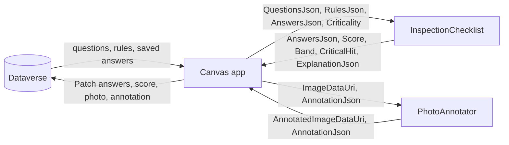

# App 2: Canvas + PCF build plan

App 2 is a copy of App 1 in which the three jobs Canvas couldn't do well are handed to two React + TypeScript code components. Everything else stays Canvas: screens, navigation, and every Dataverse read and write. Both apps write to the same tables, and App 2 stamps each inspection **Built with = Canvas + PCF**, so the Home KPIs compare the two on real records.

Decisions (owner, 2026-10-17): a separate app, so App 1 stays as the untouched baseline; two components, not one; compound risk rules stored as rows in a new `fp_riskrule` table.

## The boundary

Code components in canvas apps can't call the Dataverse Web API ([PCF limitations](https://learn.microsoft.com/power-apps/developer/component-framework/limitations)). So the Canvas app loads rows and passes them in as JSON, and the components hand results back through output properties. Canvas then patches Dataverse. The components hold no data of their own and never touch browser storage.

## Components

Both are virtual (React) field components that use the platform's React 16.14 and Fluent UI v9 libraries, so they pick up the app's modern theme and ship a small bundle ([React controls & platform libraries](https://learn.microsoft.com/power-apps/developer/component-framework/react-controls-platform-libraries)). Namespace `Fusion`; publisher prefix `fp`.

### InspectionChecklist

Replaces the question gallery, stage tabs and live risk panel on the inspection screen.

| Property | Direction | Type | Purpose |
| --- | --- | --- | --- |
| `QuestionsJson` | in | Multiple | All questions for the equipment type: id, code, parent id, stage, answer type, options, show condition, risk condition, weight, critical, `fp_rulejson`. Depth is ignored. |
| `RulesJson` | in | Multiple | Active `fp_riskrule` rows for the equipment type. |
| `AnswersJson` | in | Multiple | Saved answers, to resume a draft. |
| `Criticality` | in | SingleLine.Text | Low, Medium or High (multiplier 1.0, 1.25, 1.5). |
| `ReadOnly` | in | TwoOptions | For the review screen. |
| `AnswersOut` | out | Multiple | Answers for visible questions only, with each question's risk contribution. |
| `Score`, `Band`, `CriticalHit` | out | Decimal, Text, TwoOptions | The live result. |
| `AnsweredCount`, `VisibleCount` | out | Whole number | For the review summary. |
| `ExplanationJson` | out | Multiple | Every point in the score, by question and by rule. |

Logic lives in a pure TypeScript engine (`engine/`) with unit tests, separate from the React view:

- **Visibility by recursion, with no depth limit.** A question is visible when its parent is visible and the parent's answer meets the show condition. FL-01.1.1.1.1.1 (sixth level) appears. This removes limit A1/A2.
- **Cross-question rules** (`fp_rulejson`, any/all trees of any depth) are evaluated generically. FL-32 follows the stored rule, not a hard-coded formula. This removes A3.
- **Compound risk rules** from `fp_riskrule` add bonus points when every condition is met by visible answers. This removes A8.
- **Hidden answers never score**, and the explanation lists every point.

### PhotoAnnotator

Replaces the transparent Pen input on the photos screen.

| Property | Direction | Type | Purpose |
| --- | --- | --- | --- |
| `ImageDataUri` | in | Multiple | The photo, passed as `JSON(Photo, JSONFormat.IncludeBinaryData)`. |
| `AnnotationJson` | in | Multiple | Saved marks, so annotations stay editable. |
| `AnnotatedImageDataUri` | out | Multiple | The photo with marks burned in, at the original resolution. |
| `AnnotationJsonOut` | out | Multiple | Each mark as data: type, position, colour, number, note. |

Tools: numbered marker, arrow, rectangle, freehand and text note, with per-mark select, move, delete and undo. Coordinates are stored relative to the image (0–1), so marks line up at any display size. This removes A5.

## The Canvas side (App 2)

1. Create a blank tablet canvas app, **CanvasVsPcfInspection App 2**, in the `CanvasVsPcfInspection` solution, with co-authoring on (owner).
2. Compile App 1's source into it, then change only:
   - Home header "APP 2 OF 2 · CANVAS + PCF";
   - the new-inspection Patch stamps Built with = Canvas + PCF;
   - the inspection screen hosts InspectionChecklist; the review screen reads its outputs;
   - Submit writes `AnswersOut` (via `ParseJSON`), score and band;
   - the photos screen hosts PhotoAnnotator and patches `fp_annotatedphoto` and `fp_annotationjson`.
3. Load `fp_riskrule` rows for the equipment type when the inspection starts.

## Prerequisites

- Power Platform CLI (installed 2026-10-17, `pac` 2.13.1) and Node.js 24.
- In the Power Platform admin center, the environment setting **Allow publishing of canvas apps with code components** must be on (owner).
- Deployment: `pac auth create` with device code in the owner's browser, then `pac pcf push` for development and a solution package for the release.

## Build order and checkpoints

1. **Engine first.** The visibility, rules and scoring engine with unit tests against the seed data. Checkpoint: the tests show the sixth level, FL-32 and the compound rules working.
2. **InspectionChecklist UI** in the PCF test harness (`npm start`).
3. **PhotoAnnotator** in the test harness.
4. **Deploy** both components to the environment (owner signs in).
5. **App 2 canvas app** wired to the components. Checkpoint: owner test run with Monitor.
6. **docs/how-pro-code-solved-it.md**: each limit A1–A10 against the technique that removed it, with evidence from both apps.

## To verify while building

- Passing a photo in and out as a data URI: size limits, and whether `Patch` to an image column accepts the returned data URI.
- Output change events: how often `OnChange` fires in Canvas, and the cost of `ParseJSON` on each answer.
- The component inside an auto-layout container: sizing from `allocatedWidth` and `allocatedHeight`.
